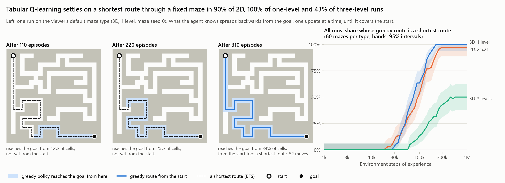

# Maze Q-learning

[](https://github.com/easensoy/maze-qlearning-rl-agent/actions/workflows/ci.yml)
[](LICENSE)

A tabular Q-learning agent that learns the shortest route through a fixed maze, a live 3D viewer of its training, and an evaluation that measures what it learns and what it does not.

On the viewer's default maze type, the agent's greedy route settles on a shortest route in **60 of 60 runs**, after a median of 75,000 steps of experience. A random walk takes about 16,000 steps (median) just to reach the goal once. Learning time grows linearly with the route's length: given three times the episodes, all 180 evaluation runs converge, including the long three-level mazes. The agent learns one maze only, and reaches the goal on 0 of 9,000 tests on mazes it has not seen.

The project started from code whose agent never learned at all. The [case study](docs/evaluation/case-study.md) traces the five stacked defects behind that, and how each fix was measured.



## Results

180 mazes, each trained with its own exploration seed for 1000 episodes of up to 1000 steps, with 95% intervals ([full evaluation](docs/evaluation/README.md)):

| Maze type, 60 mazes each | Greedy route converged to a shortest route | Steps of experience to converge, median | With 3000 episodes | Unseen mazes: greedy route reaches the goal |
|---|---|---|---|---|
| 2D, 21x21 | 54/60 (80–95%) | 98k | 60/60 | 0 of 3,000 |
| 3D, 1 level (viewer default) | 60/60 (94–100%) | 75k | 60/60 | 0 of 3,000 |
| 3D, 3 levels | 26/60 (32–56%) | not reached by most runs | 60/60 | 0 of 3,000 |

- **Training success is not learning.** On three-level mazes, 99% of late training episodes reach the goal, but only 43% of runs end with a greedy route that has settled on a shortest route.
- **Long routes need more episodes, not a longer horizon.** It takes about 7 to 9 episodes per move of route before the greedy route first becomes a shortest route (correlation 0.92 to 0.98). A discount of 0.99 rescues 2 of the 40 failing runs; three times the episodes rescues all 40.
- **The original defects interact.** Undoing the step cap alone costs 18 to 27 points of convergence, and undoing the action rule alone 2 to 8, but undoing both costs 38 to 75.
- **It learns a route, not a map.** Along its route the learned values are off by only 0.01 to 0.06 on average (the goal is worth 100), but its greedy action is optimal in only 54% to 68% of the maze.
- **Exploration is systematic, not random.** Valuing untried actions at 0 makes the agent reach the goal for the first time 7 to 9 times sooner than a random walk on one-level mazes.

## Run it

**Live viewer** (Python 3.13, Node 22). On Windows, `start_backend.bat` and `start_frontend.bat` do the same; [docs/demo.md](docs/demo.md) describes the controls.

```bash
# Terminal 1: the training server, on ws://localhost:8765
python -m venv .venv
.venv/Scripts/python -m pip install -r maze_runner_rl/requirements.txt   # .venv/bin/python on Linux and macOS
cd maze_runner_rl && ../.venv/Scripts/python main.py

# Terminal 2: the viewer, on http://localhost:3001
cd maze-3d-frontend && npm ci && npm start
```

Or `docker compose up --build`, then open http://localhost:3001.

**Evaluation and tests**, from `maze_runner_rl/` with the virtual environment's Python:

```bash
python -m pip install -r requirements-dev.txt
python -m pytest                              # 53 tests
python -m experiments.evaluate --quick        # smoke run, under a minute
python -m experiments.evaluate                # the full suite behind the numbers above
python -m experiments.plot_evaluation         # the figures
```

## How it works

- **Mazes:** a 2D generator builds perfect mazes (one route between any two cells); a 3D generator builds one or more levels joined by shafts, adds short side corridors and trims dead ends, and never disconnects the maze. Both are seeded and reproducible.
- **Environments:** Gymnasium API, with `step_from_state()` exposing the deterministic transition model so planners and tests can use it. The maze stays fixed across resets.
- **Agent:** tabular Q-learning over the agent's cell, epsilon-greedy, with untried actions valued at 0. That makes unexplored moves look better than ones that already cost step penalties, which turns the first episodes into a systematic search.
- **Server and viewer:** a WebSocket server trains in a worker thread and streams the maze, the agent's moves, statistics and Q-values to a React/Three.js viewer, capped at 30 updates a second.
- **Evaluation:** independent mazes and exploration seeds, a planner and a random walk as references (the latter computed exactly), ablations, unseen mazes, and 95% intervals. Deterministic and versioned.
- **Engineering:** 53 Python tests (including the server over a real socket) and 7 frontend tests run in CI, together with lint, the production build, and a check that both Docker images start and answer.

## Limitations

- **One maze at a time.** The Q-table only knows the agent's position, so nothing transfers to a new maze. Generalising would need the maze in the state, for example a small network over the observation.
- **Slow value propagation.** One-step updates need about 7 to 9 episodes per move of route, so the default 1000 episodes are too few for routes over about 120 moves. n-step returns, eligibility traces or experience replay would carry value back faster; they are not compared yet.
- **A narrow test bed.** One hyperparameter setting (the viewer's defaults), small deterministic mazes, the goal always in the opposite corner, and most mazes with a single route.
- **The frontend Docker image runs the development server** (1.18 GB). A production build served as static files would be far smaller.

## Repository

| Path | Contents |
|---|---|
| [`maze_runner_rl/`](maze_runner_rl) | Python: generators, environments, agent, server, experiments and tests ([README](maze_runner_rl/README.md)) |
| [`maze-3d-frontend/`](maze-3d-frontend) | React/Three.js viewer ([README](maze-3d-frontend/README.md)) |
| [`docs/evaluation/`](docs/evaluation) | The evaluation report, its figures and raw results; the [debugging case study](docs/evaluation/case-study.md) |
| [`docs/demo.md`](docs/demo.md) | The live viewer: how to run it and what it shows |
| `.github/workflows/ci.yml` | Tests, lint, build and Docker checks on every push |

MIT licensed; see [LICENSE](LICENSE).
