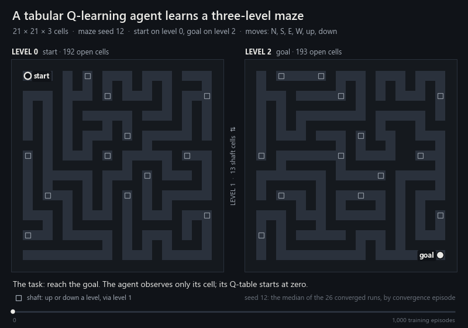
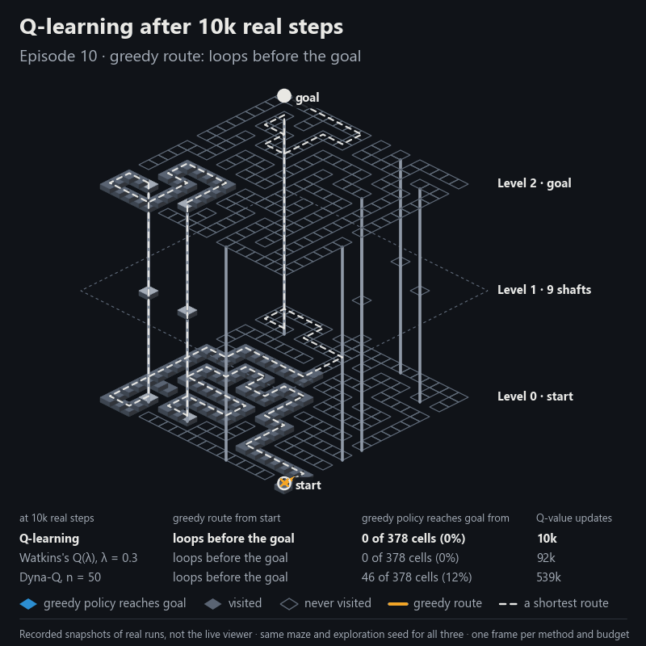
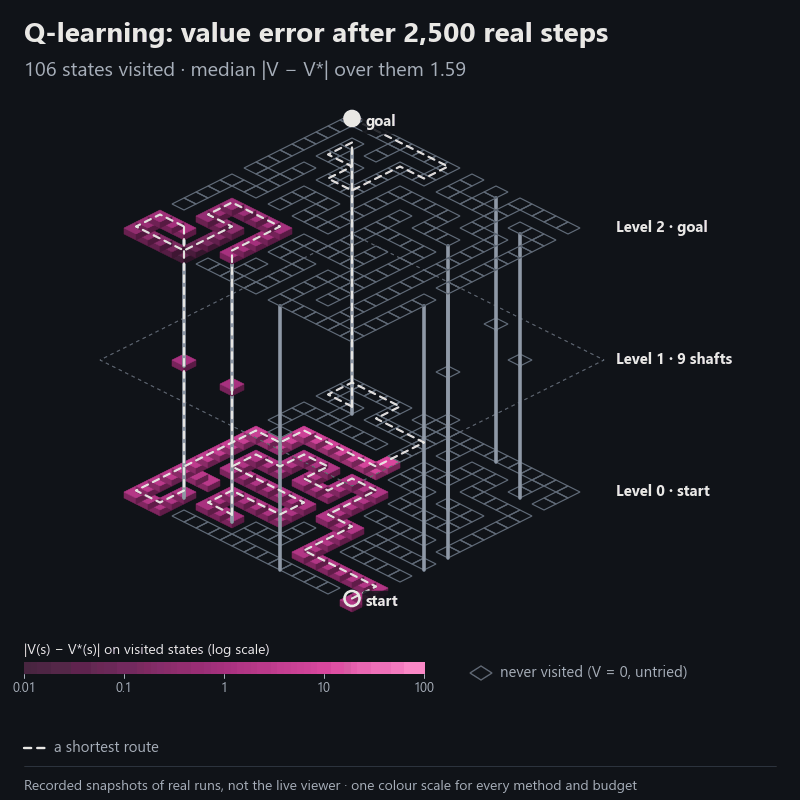

# Value propagation on long-horizon mazes: Q-learning, Watkins's Q(λ) and Dyna-Q

[](https://github.com/easensoy/maze-qlearning-rl-agent/actions/workflows/ci.yml)
[](LICENSE)

**Abstract.** On seeded 2D and three-level grid mazes, tabular Q-learning never converges within 1,000 episodes on routes longer than 120 moves. Two methods replace only its update rule:

- Watkins's Q(λ), which uses eligibility traces;
- Dyna-Q, which adds backups from a learned deterministic model.

Their settings were frozen on development mazes. All three methods then ran on 210 final mazes, paired by maze and exploration seed. On routes longer than 120 moves, the greedy route converged in 0 of 60 Q-learning runs, 30 of 60 Q(λ) runs and 60 of 60 Dyna-Q runs. Where both converged, Dyna-Q used 14–18× fewer environment steps than Q-learning, at 2.8–3.6× the Q-value updates. Dyna-Q also changes exploration, so these results are consistent with a propagation bottleneck but do not isolate it.

<picture>
  <source media="(prefers-reduced-motion: reduce)" srcset="docs/assets/hero-poster.png">
  
</picture>

<sub>Recorded replay of two logged runs, rendered offline; this is not the live viewer. <a href="docs/assets/README.md#the-animation">Text version</a>.</sub>

## Results

| Final mazes (runs per method) | Q-learning | Q(λ), λ = 0.3 | Dyna-Q, n = 50 |
|---|---|---|---|
| 2D, 21 × 21 (60) | 54 | 60 | 60 |
| One level, 21 × 21 (60) | 60 | 60 | 60 |
| Three levels, 21 × 21 × 3 (60) | 26 | 45 | 59 |
| Long routes, at least 141 moves (30) | **0** | **15** | **30** |

<sub>Converged runs: the greedy route was shortest at every check over at least the final 100 of 1,000 episodes. Intervals and tests are in the <a href="docs/value-propagation/README.md#results">report</a>.</sub>

## 1. Matched real interactions

**At equal real interactions, Dyna-Q's greedy route is shortest from 40k steps and reaches the goal from 77% of cells. At 160k, Q-learning's and Q(λ)'s routes still loop, and their greedy policies reach the goal from 4% and 10% of cells.**

<picture>
  <source media="(prefers-reduced-motion: reduce)" srcset="docs/assets/analysis/comparison.png">
  
</picture>


<sub>A fixed rule chose the maze: the median route among the 34 mazes where Dyna-Q converged and Q-learning did not. It represents that subset. Q(λ) converged on 19 of the 34, this one included. <a href="docs/assets/analysis/README.md#1-matched-interaction-comparison">Frame-by-frame table</a>.</sub>

## 2. Value error and Bellman residual

**After 40k real steps, Dyna-Q's values match V* within 0.01 on 72% of visited states, and on all of them from 80k. Q-learning's and Q(λ)'s median errors are 2.4 and 3.4. At 160k, their positive Bellman residuals remain within 14 moves of the goal.**

<picture>
  <source media="(prefers-reduced-motion: reduce)" srcset="docs/assets/analysis/value.png">
  
</picture>


<sub>e(s) = V(s) − V*(s), with untried actions at 0 and V* by value iteration. ρ(s) = maxₐ [r + γ(1 − done)V(s′)] − V(s). Residual bands show local inconsistency, not individual backups. <a href="docs/assets/analysis/README.md#2-value-error-and-bellman-residual">Definitions and tables</a>.</sub>

## 3. Interaction–computation trade-off

**Pooled over 210 final mazes, half of Dyna-Q's runs hold a shortest greedy route after 8.9k real steps, against Q-learning's 131k. Measured in Q-value updates, Dyna-Q needs 456k to Q-learning's 131k. On all 139 jointly converged mazes, Dyna-Q used fewer steps and more updates.**


<sub>A finished run keeps its final state; bands are 95% Wilson intervals.
- **Second figure:** it pairs jointly converged mazes and counts the rest at its margins.
- **D:** the development sweep. Filled markers are non-dominated.
- **E:** concurrent-worker wall-clock time, indicative only.</sub>

## 4. Failure mechanisms

**A. Long eligibility traces.** **With λ = 0.9, Q(λ) visits 26 of 185 cells within 208 steps and never returns to its one frontier cell in the next 999,791. One intervention, specified before its first run, cuts traces at untried next actions. It lifts median development coverage from 16% to 58%, against 100% for Q-learning, so the cut rule explains part of the collapse.**


**B. Dyna-Q on maze 58.** **Dyna-Q's first route to the goal, at episode 74, is 114 moves and never changes. Three moves from the goal, the goal-ward action was never taken (Q = 0), while the tried actions carry 49.5–53.1. Q-learning visited the shaft beyond by episode 60 and found the 106-move route at episode 703.**


<sub>Observations come from replays checked against the published records; B's mechanism is an untested hypothesis. <a href="docs/assets/analysis/README.md#4-failure-cases">Case studies</a>.</sub>

## Reproduction

Python 3.13; every command calls the repository's virtual environment explicitly.

```powershell
# Windows (PowerShell), from the repository root, then from maze_runner_rl\
py -3.13 -m venv .venv; .venv\Scripts\python.exe -m pip install -r maze_runner_rl\requirements-dev.txt
cd maze_runner_rl; $PY = "..\.venv\Scripts\python.exe"     # then run the commands below as & $PY -m ...
```

```bash
# Linux and macOS, from the repository root, then from maze_runner_rl/
python3.13 -m venv .venv && .venv/bin/python -m pip install -r maze_runner_rl/requirements-dev.txt
cd maze_runner_rl && PY=../.venv/bin/python
# 1. Render from committed data; nothing is trained or planned
$PY -m experiments.render_analysis      # comparison, value and failure visuals, figures.json
$PY -m experiments.plot_tradeoff        # trade-off figures
$PY -m experiments.render_hero          # the 3D replay above
# 2. Capture diagnostic checkpoints: retrains published runs, stops on any mismatch with their records
$PY -m experiments.capture_analysis     # snapshots for analyses 1, 2 and 4 (about 30 s)
$PY -m experiments.diagnose_trace_cut   # the trace-cut intervention (about 50 s)
# 3. Reproduce the published experiment with the committed frozen settings, into a separate folder
$PY -m experiments.compare_methods final --settings ../docs/value-propagation/frozen_settings.json --out ../reproduction/final
$PY -m experiments.compare_methods verify --out ../reproduction/final
```

## Further reading

- [Value-propagation report](docs/value-propagation/README.md): methods, equations, protocol, statistics, all tables, retuning and limitations.
- [Visual analyses](docs/assets/analysis/README.md): data sources, definitions and text equivalents.
- [Baseline evaluation suite](docs/evaluation/README.md) · [Debugging case study](docs/evaluation/case-study.md) · [Live 3D viewer](docs/demo.md).

**Scope.**
- Tabular agents on deterministic mazes of at most 21 × 21 × 3.
- One exploration seed per maze.
- Settings frozen by commit, not preregistered.

MIT licensed.
