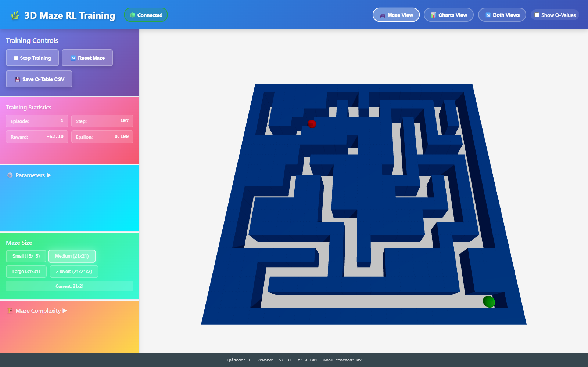

# Interactive training viewer

[README](../README.md) · [Evaluation](evaluation/README.md) · [Debugging case study](evaluation/case-study.md)



A React and Three.js front end shows the agent while it trains. A Python WebSocket server runs the Q-learning loop and streams the maze, the agent's position, the statistics and the Q-values.

## Run it

### Backend

```bash
# Windows: double-click start_backend.bat (creates .venv on the first run), or:
py -3.13 -m venv .venv
.venv\Scripts\python.exe -m pip install -r maze_runner_rl\requirements.txt
cd maze_runner_rl
..\.venv\Scripts\python.exe main.py
```

The server listens on `ws://localhost:8765` (see `maze_runner_rl/websocket/config.yaml`).

### Frontend

```bash
# Windows: double-click start_frontend.bat (runs npm ci on the first run), or:
cd maze-3d-frontend
npm ci
npm start
```

Open **http://localhost:3001** (the port is set in `maze-3d-frontend/.env`).

### Docker

`docker compose up --build` starts the backend on port 8765 and the frontend on port 3001. The frontend image is a multi-stage build: `npm run build` produces the production bundle, which nginx serves as static files.

The WebSocket is opened by the browser, not by the container, so the bundle must contain a URL the browser can reach. The default is `ws://localhost:8765`, the backend's published port. Create React App inlines `REACT_APP_*` variables at build time, so another server is set with a build argument:

```bash
REACT_APP_WS_URL=ws://example-host:8765 docker compose up --build
docker build --build-arg REACT_APP_WS_URL=ws://example-host:8765 -t maze-frontend maze-3d-frontend
```

CI builds both images on every push and pull request. It checks that the backend answers with a snapshot and that nginx serves a hashed production bundle. It then loads the page in headless Chrome and waits for the viewer's WebSocket indicator to read "Connected" ([`.github/scripts/viewer_connects.py`](../.github/scripts/viewer_connects.py)).

## Controls

- **Training:** Start and Stop; Reset Maze builds a new maze and starts a fresh agent; Save Q-Table CSV writes the best action for each cell.
- **Parameters**, adjustable while training:
  - learning rate, 0.01 to 1.0;
  - epsilon (exploration rate), 0.01 to 1.0;
  - speed, from 0.1 steps per second up to unthrottled (the top of the logarithmic slider removes the delay between steps);
  - episodes per run, 10 to 10,000, each of up to 1000 steps.
- **Maze size:** Small 15x15, Medium 21x21, Large 31x31, or 21x21 with 3 levels.
- **Maze complexity:** wall density and branching factor, described below.
- **Views:** maze, charts or both, and a Q-value overlay.

## Reading the display

- **Maze:** blue wall blocks on a dark floor. A multi-level maze is laid out level by level, side by side, with shaft tiles (amber is a way up, cyan a way down).
- **Agent and goal:** the red sphere is the agent, the green sphere the goal. Both are drawn on top, so walls never hide them.
- **Q-value overlay:** each floor tile is coloured by the best learned value of its cell, from red (lowest) to green (highest).
- **Statistics:** episode, step, reward and epsilon. The footer counts how often the goal was reached.
- **Charts:** the reward of each of the last 100 episodes with a 10-episode moving average, and the steps per episode. Average and best reward and steps sit above them.

Reaching the goal during training is not the same as having learned the shortest route, because training episodes still include random exploratory moves. The [evaluation](evaluation/README.md) checks the learned (greedy) route separately.

## Maze settings

- **Wall density, 0.60 to 0.85:** the target share of wall cells. Dead ends are trimmed towards it, and trimming stops early once none are left, so high targets may not be reached.
- **Branching factor, 0.20 to 0.60:** how many short side corridors are carved (0.4 gives 10). A side corridor that meets another corridor creates a loop, and so an alternative route. Most do not, and they are trimmed again as dead ends: with the default settings, 47 of the 60 one-level evaluation mazes have a single route, and 30 of the 60 three-level ones (`docs/evaluation/results/baselines.csv`, column `loops`).

## How it works

1. The backend generates a maze. It stays the same for the whole training run, so the Q-table can learn it.
2. The server sends the maze to the frontend when it changes, and per-step updates at most 30 times a second.
3. Three.js renders the walls, the agent and the goal.
4. The agent trains with tabular Q-learning and an epsilon-greedy policy, in a worker thread.
5. The frontend updates the agent's position and the statistics live; the charts show training progress.
6. Parameter changes from the controls reach the running training loop immediately.

## Technical stack

**Backend (Python)**

- WebSocket server for two-way, real-time messages; per-step updates capped at 30 per second.
- Maze generators: depth-first search (recursive backtracker), plus side corridors and dead-end shaping that never disconnect the maze.
- Gymnasium environments for 2D and multi-level 3D mazes (`reset() -> (obs, info)`, five-value `step()`).
- Tabular Q-learning agent with epsilon-greedy exploration; untried actions count as 0.
- Training loop in a worker thread that hands messages to the asyncio loop.

**Frontend (React + Three.js)**

- Three.js through React Three Fiber for the 3D scene.
- One WebSocket connection per tab, with automatic reconnect.
- Recharts for the performance charts.
- Layout that adapts below 1200 px and 768 px.

## Project structure

```
├── maze_runner_rl/
│   ├── main.py                        # Entry point: python main.py
│   ├── websocket/
│   │   ├── config.yaml                # Server, training, agent and maze settings
│   │   └── websocket_server.py        # WebSocket RL server
│   ├── config/                        # Environment settings (rewards, actions)
│   ├── experiments/
│   │   ├── training_experiment.py     # One training run from the command line
│   │   ├── evaluate.py                # Evaluation suite (docs/evaluation)
│   │   └── plot_evaluation.py         # Evaluation figures
│   ├── src/
│   │   ├── environments/              # 2D and 3D mazes and their generators
│   │   ├── agents/q_learning_agent.py # Q-learning implementation
│   │   └── algorithms/policy_iteration.py  # Exact solver for comparison
│   └── tests/                         # pytest suite
├── maze-3d-frontend/
│   └── src/
│       ├── components/                # Maze3D, TrainingControls, TrainingCharts
│       ├── hooks/useWebSocket.js      # WebSocket connection
│       └── App.js
├── docs/                              # This guide and the evaluation
├── start_backend.bat, start_frontend.bat
└── docker-compose.yml
```
