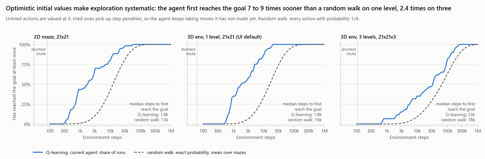
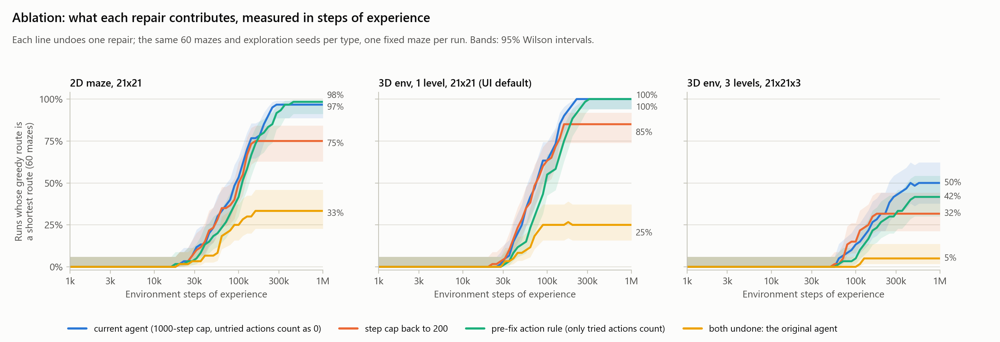
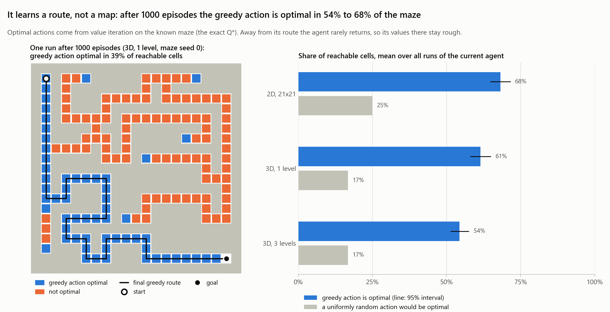
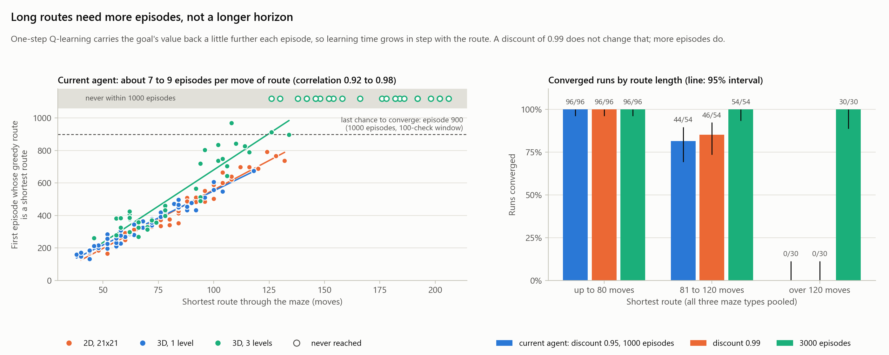

# Evaluation

[README](../../README.md) · [Debugging case study](case-study.md) · [Interactive viewer](../demo.md)

What the tabular Q-learning agent in this repository learns, how much experience it needs, and what it does not learn. It is measured on 180 independently generated mazes, against a random walk and an exact planner, with 95% intervals. Every number on this page comes from [`results/`](results), produced by [`evaluate.py`](../../maze_runner_rl/experiments/evaluate.py); the figures come from [`plot_evaluation.py`](../../maze_runner_rl/experiments/plot_evaluation.py).


## Summary

- **It learns a fixed maze.** The greedy route settles on a shortest route in 60 of 60 one-level runs, 54 of 60 2D runs and 26 of 60 three-level runs. The median converged run needed 75,000 to 98,000 environment steps of experience; a planner given the maze needs none.
- **Reaching the goal is not the same as learning the route.** On three-level mazes, 99% of the last 100 training episodes reach the goal, but only 43% of the runs have a greedy route that stays a shortest route.
- **Learning time grows linearly with route length**, by about 7 to 9 episodes per move (correlation 0.92 to 0.98), so routes longer than about 120 moves run out of the 1000-episode budget. Three times the episodes makes all 180 runs converge; a longer horizon (discount 0.99) rescues only 2 of the 40 failing runs.
- **The repairs interact.** Undoing only the step cap costs 18 to 27 points of convergence and undoing only the action rule 2 to 8, but undoing both costs 38 to 75.
- **It learns a route, not a map.** On its route the learned values are off by only 0.01 to 0.06 on average (the goal is worth 100), but its greedy action is optimal in only 54% to 68% of the maze.
- **Nothing transfers.** Trained agents reach the goal on 0 of 9,000 tests on unseen mazes, as expected for a Q-table that only knows the agent's position.

## Setup

**Tasks.** Three maze types, 60 mazes each (maze seeds 0 to 59):

| Maze type | Open cells (median) | Mazes with a single route | Shortest route, moves (median, range) |
|---|---|---|---|
| 2D maze, 21x21 | 189 | 60 of 60 | 82 (40 to 152) |
| 3D env, 1 level, 21x21 (the viewer's default) | 152 | 47 of 60 | 62 (38 to 118) |
| 3D env, 3 levels, 21x21x3 | 395 | 30 of 60 | 107 (46 to 206) |

The agent starts in one corner and the goal is in the opposite corner (on the top level of a 3-level maze). The maze stays the same for the whole run.

**Agent.** Tabular Q-learning on the agent's cell index, with the repository's settings (`websocket/config.yaml`): learning rate 0.1, discount 0.95, epsilon 0.1 decaying by 0.995 per episode to 0.01, and untried actions valued at 0. Each run has 1000 episodes of up to 1000 steps. Rewards: +100 for reaching the goal, -0.1 per move, -1 for bumping into a wall.

**Seeds.** Each run has its own maze seed and its own exploration seed (500000 plus the maze seed) for the agent's random choices. Every setting uses the same mazes and exploration seeds, so settings can be compared run by run.

**What is measured.** After every episode the greedy policy (no exploration) is followed from the start:

- does it reach the goal, and is its route a shortest route? (In every run here, a greedy route that reached the goal was a shortest route.)
- **Converged** means the greedy route was a shortest route at every check for at least the last 100 episodes. A run that only got there near the end counts as not converged; it is not dropped.
- **Experience** is counted in environment steps, every move being one step, because episodes vary in length: early ones often use all 1000 steps, late ones about as many as the shortest route.

**References.**

- **Planner:** breadth-first search and value iteration, both given the maze's transition model. They need no experience at all, which is the point of the comparison: Q-learning has to learn what a planner is told.
- **Random walk:** every action with equal probability, never learning. Its chance of reaching the goal within t steps is computed exactly from the transition matrix, not by sampling. The tests check this against step-by-step propagation and a corridor with a known answer.

**Statistics.** Proportions have 95% Wilson intervals. Medians and means have 95% percentile bootstrap intervals (10,000 resamples). Differences between settings use a paired bootstrap over the shared mazes. A run that never reaches an event counts as infinitely late, so a median can be "not reached".

## Results

### 1. Learning a fixed maze

| Maze | Greedy route converged | Steps of experience to converge (median) | Episodes to converge (median) | Greedy route shortest after the last episode | Training episodes reaching the goal, last 100 |
|---|---|---|---|---|---|
| 2D maze, 21x21 | 54/60, 90% (80–95) | 98k (84k–118k) | 556 (475–603) | 97% (89–99) | 100% |
| 3D env, 1 level (default) | 60/60, 100% (94–100) | 75k (64k–98k) | 392 (352–458) | 100% (94–100) | 100% |
| 3D env, 3 levels | 26/60, 43% (32–56) | not reached | not reached | 50% (38–62) | 99% (99–100) |

On the viewer's default maze type every run converges. The hero figure shows how: the set of cells from which the greedy policy reaches the goal grows backwards from the goal, because each update only passes value one step back, until it covers the start. Until then the greedy route from the start loops within a few moves; after that it is a shortest route at once.

The three-level row shows why training success alone is misleading: almost every late training episode reaches the goal, helped by exploration and by updates made during the episode, yet half of the frozen greedy policies never get there.

### 2. Against the references



| Maze | Planner given the maze | Random walk reaches the goal within 1000 steps | Random walk, steps to the goal (median maze: median, expected) | Q-learning, steps until it first reaches the goal (median) | Q-learning, steps until its greedy route converges (median) |
|---|---|---|---|---|---|
| 2D maze, 21x21 | shortest route in 60/60 mazes, no experience | 0.9% (0.4–1.4) | 12.7k, 17k (209x the shortest route) | 1.8k (828–2.9k) | 98k (84k–118k) |
| 3D env, 1 level | shortest route in 60/60 mazes, no experience | 0.3% (0.2–0.4) | 15.7k, 21k (352x) | 1.8k (1.2k–3.7k) | 75k (64k–98k) |
| 3D env, 3 levels | shortest route in 60/60 mazes, no experience | <0.1% | 77.6k, 111k (925x) | 33k (14k–54k) | not reached |

A random walk almost never reaches the goal within one 1000-step episode. The agent's first arrival comes 7 to 9 times sooner than the random walk's median on the one-level mazes, and 2.4 times sooner on three levels. That is the effect of valuing untried actions at 0: moves that have already cost step penalties look worse than new ones, so the first episodes become a systematic search rather than a random one. The planner column is the price of not having a model: about 10^5 steps of experience for what breadth-first search computes from the map.

### 3. Which repairs matter



| Setting | 2D maze, 21x21 | 3D env, 1 level | 3D env, 3 levels |
|---|---|---|---|
| Current agent (1000-step episodes, untried actions count as 0) | 54/60 converged | 60/60 | 26/60 |
| Step cap back to 200 | 40/60: −23 points (−35 to −13) | 44/60: −27 (−38 to −17) | 15/60: −18 (−28 to −8) |
| Pre-fix action rule (only tried actions count) | 53/60: −2 (−5 to 0) | 59/60: −2 (−5 to 0) | 21/60: −8 (−17 to −2) |
| Both undone: the original agent | 19/60: −58 (−70 to −47) | 15/60: −75 (−85 to −63) | 3/60: −38 (−52 to −27) |

Each row runs on the same mazes with the same exploration seeds, and the change is paired against the current agent. The longer episodes matter most on their own. The action rule barely matters once episodes are long enough to stumble on the goal. Together the two defects collapse learning: with 200-step episodes and only tried actions considered, most runs never reach the goal often enough to learn from it. On maze seeds 0 to 4 the original agent reaches the goal in 0% of training episodes, as the [audit](case-study.md) found; across all 60 mazes it converges on 19, mostly those with short routes.

### 4. Unseen mazes

| Maze | Trained on one maze: greedy route reaches the goal on 50 unseen mazes | Trained on a new maze every episode: training episodes reaching the goal, last 100 | Trained on a new maze every episode: greedy route reaches the goal on unseen mazes |
|---|---|---|---|
| 2D maze, 21x21 | 0 of 3,000 tests | 0% | 0 of 3,000 |
| 3D env, 1 level | 0 of 3,000 | <0.1% | 0 of 3,000 |
| 3D env, 3 levels | 0 of 3,000 | 0% | 0 of 3,000 |

The Q-table is indexed by the agent's position only, so what it learns about one maze says nothing about another, and training on a new maze every episode (the original environment's behaviour) learns nothing at all. Generalising across mazes needs the maze in the state, for example a network over the observation.

### 5. What the converged policy knows



| Maze | Cells visited in training | Greedy action optimal, all reachable cells | Greedy action optimal, visited cells | A uniformly random action would be optimal | Value error on the final greedy route (goal reward 100) |
|---|---|---|---|---|---|
| 2D maze, 21x21 | 88% | 68% (65–72) | 74% | 25% | 0.02 |
| 3D env, 1 level | 95% | 61% (58–65) | 63% | 17% | 0.01 |
| 3D env, 3 levels | 91% | 54% (51–58) | 58% | 17% | 0.06 |

Optimal actions and values come from value iteration on the known maze. Along its own route the agent's values match the exact ones closely; elsewhere its greedy action is right in only about half to two-thirds of the cells, because exploration has died down long before those values are accurate.

### 6. Why long routes do not converge



The episode at which the greedy route first becomes a shortest route grows in a straight line with the route's length: 7.2 episodes per move on 2D mazes, 6.7 on one level and 8.9 on three levels (correlation 0.98, 0.98 and 0.92). With 1000 episodes and a 100-check window, a run must get there by episode 900, which those lines reach at roughly 125 to 150 moves. No run with a route over 120 moves converged.

Two explanations fit, and they predict different things:

1. **The goal fades.** With discount 0.95 and a −0.1 step penalty, never arriving is worth −2, and from 150 moves away the goal adds only 0.05 to that, small enough to be lost in the learning noise. If this were the cause, a discount of 0.99 should help: it raises the goal's advantage, seen from 150 moves away, from 0.05 to 25.
2. **The budget runs out.** One-step Q-learning carries the goal's value back only a little further each episode, so a longer route needs proportionally more episodes. If this were the cause, more episodes should help.

Both were tested on the same mazes with the same exploration seeds:

| Maze | Shortest route | Runs | Converged: current agent | Discount 0.99 | 3000 episodes |
|---|---|---|---|---|---|
| 2D maze, 21x21 | up to 80 moves | 30 | 30 | 30 | 30 |
| | 81 to 120 moves | 26 | 24 | 26 | 26 |
| | over 120 moves | 4 | 0 | 0 | 4 |
| 3D env, 1 level | up to 80 moves | 46 | 46 | 46 | 46 |
| | 81 to 120 moves | 14 | 14 | 14 | 14 |
| 3D env, 3 levels | up to 80 moves | 20 | 20 | 20 | 20 |
| | 81 to 120 moves | 14 | 6 | 6 | 14 |
| | over 120 moves | 26 | 0 | 0 | 26 |
| **All** | | **180** | **140** | **142** (+1 point, 0 to +3) | **180** (+22 points, 16 to 28) |

The discount rescues 2 of the 40 runs that failed; three times the episodes rescues all 40. The bottleneck is how fast value propagates back from the goal, not how far ahead the agent can see. Methods that carry value back faster than one step per update, such as n-step returns, eligibility traces or replaying past experience, are the natural next comparison.

## Limitations

- **One maze at a time.** A tabular, position-only agent memorises the maze it is trained on; nothing transfers (section 4).
- **One setting.** The agent uses the viewer's default hyperparameters; nothing was tuned. The 1000-episode budget is too small for routes longer than about 120 moves (section 6).
- **Small, simple mazes.** At most 1,323 cells, deterministic moves, the goal always in the opposite corner, and most mazes have a single route.
- **Censoring.** A run counts as converged only if its greedy route was stable for the last 100 episodes; runs that would have converged with more episodes count as not converged.
- **Few references.** The references bracket the agent (no learning, perfect model). Learning methods that propagate value faster, such as n-step returns, eligibility traces or Dyna-style planning, are not compared yet.

## Reproduce

From `maze_runner_rl/`, with the development requirements installed:

```bash
python -m experiments.evaluate          # 1,260 training runs, 34 minutes on 20 worker processes
python -m experiments.plot_evaluation
```

The suite is deterministic: the same code and seeds give the same `runs.csv`, `baselines.csv` and `curves.json`, byte for byte. The published results were produced at commit `7e35fcc` with no uncommitted changes to the code they depend on, and they match an earlier run of the same code, made in three parts on a busier machine, byte for byte; so do the figures. `summary.json` records the commit, a SHA-256 of that code and its settings, library versions and the run time. `--quick` runs a small version in under a minute.
