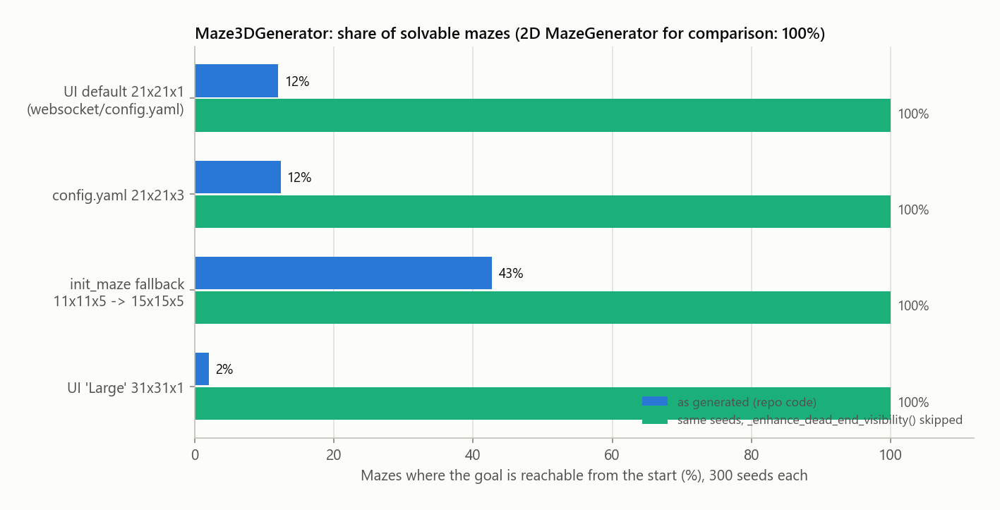

# Case study: an agent that could not learn

[README](../../README.md) · [Evaluation](README.md) · [Interactive viewer](../demo.md)

An audit of commit [`3e99fbd`](https://github.com/easensoy/maze-qlearning-rl-agent/tree/3e99fbd) (August 2025) found that every part of the system existed: maze generators, Gymnasium-style environments, a tabular Q-learning agent, a WebSocket server and a React/Three.js viewer. Yet **the agent never learned a maze, and the viewer never received training data.** With the repository's own settings, 0% of training episodes reached the goal, over 25,000 offline episodes and 100 episodes streamed live.

Five defects were stacked on top of each other, so fixing any one of them alone changed nothing visible. Each was located by measurement, fixed in its own commit, and is now covered by a test.

## The five defects

| | Symptom | How it was measured | Cause | Fix | Regression test |
|---|---|---|---|---|---|
| 1 | The viewer never showed training | The worker thread raised `RuntimeError` on its first step, so no `training_update` was ever sent | `asyncio.get_event_loop()` called from a worker thread | Capture the event loop in `start_training()` and hand messages to it with `run_coroutine_threadsafe` | `test_server.py`: a run over a real socket streams updates and ends with `training_stopped` |
| 2 | Buttons and sliders did nothing | Browser console: `WebSocket not connected, cannot send message: {type: start_training}`. Each tab held 4 open sockets and received every message 4 times | The React hook kept a closed socket as the current one and opened new ones on re-render | One socket per tab in a `useRef`, a stable `sendMessage`, and a reconnect that ignores stale sockets | `useWebSocket.test.js`: one socket under StrictMode, commands reach the new socket after a reconnect, stale sockets are ignored |
| 3 | 88% of the mazes the UI trained on were unsolvable | Breadth-first search from start to goal on 300 generated mazes per size: 12% solvable, 100% with the dead-end pass skipped (figure below) | The dead-end pass closed cells without checking that the goal stayed reachable | Close a cell only if every open cell stays reachable from the start | `test_generators.py`: 25 seeds for each of 4 sizes, all solvable and fully connected |
| 4 | Nothing learned in one episode carried over to the next | `reset()` built a new maze every episode; 65 agents trained this way solved 0 of 13,000 unseen mazes | The Q-table only sees the agent's position, so it cannot transfer between mazes | Keep the maze across resets (Gymnasium API); build a new one only for a new seed or `options={"new_maze": True}` | `test_environments.py`: a reset keeps the maze |
| 5 | 0% success even on a fixed maze | 0% of training episodes reached the goal on a fixed 2D maze; with 2000-step episodes instead of 200, the same agent learned (median convergence at episode 582) | When exploiting, the agent only considered actions it had already tried in a state, so it kept repeating its least bad move; 200 steps were too few to stumble on the goal | Untried actions count as 0, so they look better than tried ones with step penalties; the goal transition no longer bootstraps; episodes of up to 1000 steps | `test_agent.py` (update and action rules); `test_training_experiment.py` (learns the UI's default maze within 500 episodes) |

The [evaluation's ablation](README.md#3-which-repairs-matter) measures the two halves of defect 5 separately, on the same 180 mazes and exploration seeds. Undoing only the action rule costs 2 to 8 points of convergence, undoing only the longer episodes 18 to 27, and undoing both 38 to 75: each half alone does limited harm, together they stop most runs from learning. On maze seeds 0 to 4 the original agent never reaches the goal at all, as the audit found.

Smaller problems fixed along the way:

- The server re-sent the whole maze on every step; one browser tab received 259 MB of WebSocket data in about 4 minutes. A full session now moves about 1 MB.
- The Q-value heatmap rendered nothing, because the server sent state ids where the viewer expected `"x,y,z"` keys.
- A 3-level maze was drawn as one solid slab, because the viewer ignored the level.
- `policy_iteration.py` needed a transition model that neither environment provided, and `training_experiment.py` crashed: `step()` returned four values where it unpacked three, and the state was an unhashable array.
- `wall_density` and `branching_factor` were stored but never used, so mazes were identical across settings.
- `requirements.txt` and `README.md` were empty, the `.bat` launchers pointed to another machine's folders, and the Docker setup bound the server to `localhost` inside the container and mapped the wrong frontend port.

## Before and after

| | At `3e99fbd` | Now |
|---|---|---|
| Training episodes reaching the goal (last 100, repository settings) | 0% | 100% on 2D and one-level mazes, 99% on three levels (180 mazes) |
| Greedy route settles on a shortest route | never | 60/60 one-level, 54/60 2D and 26/60 three-level runs in 1000 episodes; 180/180 in 3000 |
| Solvable mazes, UI default size | 12% | 100% (1,200 generated mazes tested) |
| WebSocket traffic | 259 MB in about 4 minutes, one tab | about 1 MB for a full session |
| Stop at the slowest speed | 5 s, and a quick restart could leave two training threads running | 0.01 s, one training thread |
| Tests and CI | 1 frontend test with the connection mocked out, no CI | 53 backend tests and 7 frontend tests; CI runs them, lints and builds the frontend, and builds and starts both Docker images |

## Corrections to the measurements themselves

Some errors were in the measurement, not the code. They are kept here because they changed the conclusions.

- **The convergence rule was too generous.** The first report after the fixes counted a run as converged from the first episode after which every greedy check took a shortest route, even if that was only the final episode. One 3-level run qualified at episode 1000 with a shortest route in 6 of its last 100 checks. The rule now needs at least 100 consecutive checks (`convergence_episode`), and a run that falls short is reported as not converged rather than left out. The 3-level result dropped from 4 of 5 runs to 2 of 5.
- **"Success" meant two things.** Reaching the goal during training, with random exploratory moves, is not the same as having learned the route. All metrics now keep training success, a greedy route that reaches the goal, and a greedy route that is a shortest route apart.
- **The documentation promised more than the code did.** Wall density was described as a minimum, but trimming can stop early: with 0.85 requested, one maze ended at 0.67. Branching was described as adding loops, but most extra corridors are trimmed again: 47 of 60 one-level mazes have a single route. Both are now described as measured.
- **An outside review found a race.** At the slowest speed, Stop took 5.02 s and a quick restart could run two training threads at once. The wait between steps is now interruptible, Start and a new maze wait for the old thread to exit, and the two lifecycle tests fail on the previous server code.

## Where the changes are

- [Fixes](https://github.com/easensoy/maze-qlearning-rl-agent/compare/96aee12...dbfa486): 35 one-file commits, 6 November 2026.
- [Stop/restart race and the corrected metrics](https://github.com/easensoy/maze-qlearning-rl-agent/compare/dbfa486...51048d8): 8 commits, 7 November 2026.
- [Tests, CI, cleanup and Docker](https://github.com/easensoy/maze-qlearning-rl-agent/compare/51048d8...5bbbae8): 26 commits, 7 November 2026.
- The evaluation suite and these documents: `maze_runner_rl/experiments/evaluate.py`, [`docs/evaluation`](README.md).
