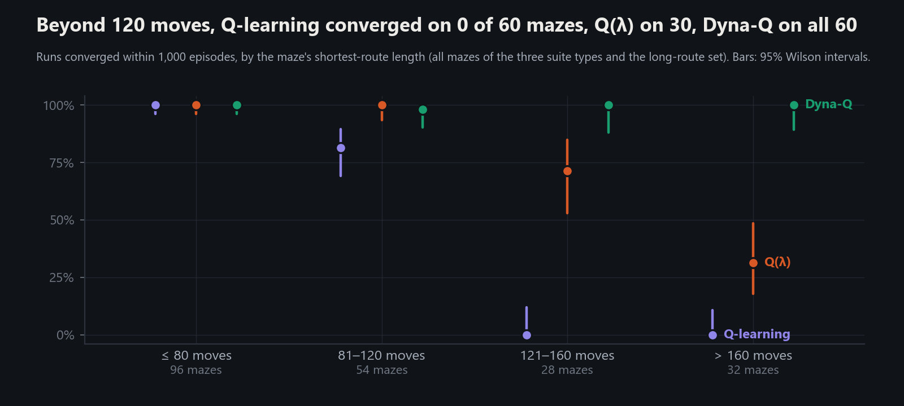

# Value propagation and long-route convergence: Q-learning, Watkins's Q(λ) and Dyna-Q

[README](../../README.md) · [Evaluation suite](../evaluation/README.md) · [Raw results](results) · [Reproduction](#reproduction)

**Summary.** Under a protocol frozen before the final runs, two methods that propagate value faster than one-step Q-learning reach persistent greedy convergence within 1,000 episodes on long routes where Q-learning does not: Dyna-Q on all of them, Watkins's Q(λ) on half.

- **Long routes.** On the 60 final mazes whose shortest route exceeds 120 moves, Q-learning converged on 0, Watkins's Q(λ) on 30 and Dyna-Q on 60.
- **Interaction–computation trade-off.** On mazes where both it and Q-learning converged, Dyna-Q used 14–18× fewer environment steps than Q-learning, at 2.8–3.6× its Q-value updates. Over a full run it used 10–16× the agent wall-clock time.
- **Changed exploration.** Dyna-Q shortened the interval from first goal arrival to the first shortest greedy route by 22–32×. On three-level mazes it also reached the goal 4.7–6.3× sooner. Q(λ) reached the goal later than Q-learning.

The results are consistent with a propagation bottleneck in one-step Q-learning. They do not establish propagation as the sole mechanism, because both interventions also change exploration. On the suite, Q-learning's failures are budget-bound: the evaluation suite shows convergence on every suite maze, with routes up to 206 moves, with 3,000 episodes. The long-route set (142–278 moves) was not run with a larger budget.

**Two failures, one measured and one traced:**

- **Q(λ) with long traces.** At λ ≥ 0.7, state coverage stalls and few runs converge.
- **Dyna-Q on 1 maze of 210.** The greedy route settled 8 moves above the optimum. A seeded replay shows the shortcut began with an action that was never taken.


## Results

The final runs are 3 methods × 210 mazes, with the same mazes and exploration seeds for every method ([`results/runs.csv`](results/runs.csv); all tables in [`results/tables.md`](results/tables.md)). The table gives, per maze set:

- **Converged:** runs that reached persistent convergence ([definitions](#protocol)), with 95% Wilson intervals.
- **Steps to convergence:** the median time to convergence over all runs, with right-censored runs counted as +∞.
- **Updates per step:** Q-value updates (real, trace and planning) per environment step, median run.
- **Agent time:** median wall-clock time inside agent calls per 1,000-episode run. Runs were one per worker process, 20 concurrent, on the recorded Intel64 Family 6 Model 170 processor.

| Maze set | Method | Converged | Steps to convergence | Updates per step | Agent time per run |
|---|---|---|---|---|---|
| 2D, 21 × 21 (60) | Q-learning | 54/60 (80–95%) | 98k | 1 | 1.8 s |
| | Watkins's Q(λ) | 60/60 (94–100%) | 63k | 23.5 | 5.9 s |
| | Dyna-Q | 60/60 (94–100%) | 5.2k | 51 | 27 s |
| One level, 21 × 21 (60) | Q-learning | 60/60 (94–100%) | 75k | 1 | 1.7 s |
| | Watkins's Q(λ) | 60/60 (94–100%) | 45k | 18.5 | 3.0 s |
| | Dyna-Q | 60/60 (94–100%) | 5.6k | 51 | 27 s |
| Three levels, 21 × 21 × 3 (60) | Q-learning | 26/60 (32–56%) | not reached | 1 | 5.5 s |
| | Watkins's Q(λ) | 45/60 (63–84%) | 223k | 23.0 | 11 s |
| | Dyna-Q | 59/60 (91–100%) | 33k | 51 | 55 s |
| Long routes, ≥ 141 moves (30) | Q-learning | 0/30 (0–11%) | not reached | 1 | 7.8 s |
| | Watkins's Q(λ) | 15/30 (33–67%) | not reached | 30.8 | 24 s |
| | Dyna-Q | 30/30 (89–100%) | 57k | 51 | 101 s |

Q-learning's rows reproduce the evaluation suite exactly. The experiment's training loop is tested to give the suite's runs check for check.

**Conditional comparison with Q-learning** (geometric means over mazes on which both methods converged, bootstrap 95% intervals). For each method: the factor by which it needed fewer environment steps than Q-learning, and the factor by which it spent more Q-value updates up to convergence.

| Maze set (pairs) | Dyna-Q: fewer steps | Dyna-Q: more updates | Q(λ): fewer steps | Q(λ): more updates |
|---|---|---|---|---|
| 2D (54 for both) | 18.3× (16.8–19.9) | 2.8× (2.6–3.0) | 1.59× (1.57–1.61) | 8.9× (8.4–9.4) |
| One level (60 for both) | 14.1× (13.2–15.1) | 3.6× (3.4–3.9) | 1.68× (1.65–1.71) | 6.5× (6.2–6.8) |
| Three levels (25 for Dyna-Q, 26 for Q(λ)) | 14.2× (12.6–16.1) | 3.6× (3.2–4.0) | 1.82× (1.74–1.92) | 6.5× (5.9–7.0) |

These ratios are conditional on convergence, so they exclude the mazes where the methods differ most. On the long-route set no pair exists, because Q-learning converged on none.

**Discordant pairs** (exact McNemar tests on mazes that only one method of the pair converged):

- **Three-level suite.**
  - Dyna-Q converged on 34 mazes where Q-learning did not, and Q-learning on 1 where Dyna-Q did not: p = 2.1 × 10⁻⁹. The converged share rose by 55 points (paired bootstrap 42–68).
  - Q(λ) against Q-learning: 19 and 0, p = 3.8 × 10⁻⁶.
- **Long-route set.** Dyna-Q 30 and Q-learning 0, p = 1.9 × 10⁻⁹. Q(λ) 15 and Q-learning 0, p = 6.1 × 10⁻⁵.
- **2D suite.** Each method converged on 6 mazes where Q-learning did not, and on none where it did not: p = 0.031.

### By route length



| Shortest route | Q-learning | Watkins's Q(λ) | Dyna-Q |
|---|---|---|---|
| up to 80 moves (96 mazes) | 96/96 | 96/96 | 96/96 |
| 81–120 moves (54) | 44/54 | 54/54 | 53/54 |
| more than 120 moves (60) | **0/60** | **30/60** | **60/60** |

The suite's finding that no route longer than 120 moves converged within 1,000 episodes holds for Q-learning on 30 further mazes. It does not hold for Dyna-Q.

## Diagnostic: which phase of learning changed

Time to the first shortest greedy route splits at the first exploratory training success:

1. **Phase 1:** environment steps until an ε-greedy training episode first reaches the goal. This measures exploration.
2. **Phase 2:** steps from there to the first instantaneous greedy optimality. This measures how quickly experience of the goal turns into a greedy route from the start.

One-step backups predict a long phase 2.


| Maze set | Phase 1, median steps (Q-learning / Q(λ) / Dyna-Q) | Phase 2, median steps (Q-learning / Q(λ) / Dyna-Q) |
|---|---|---|
| 2D | 1.8k / 5.9k / 1.1k | 80k / 51k / 2.5k |
| One level | 1.8k / 5.7k / 1.5k | 65k / 34k / 3.0k |
| Three levels | 33k / 39k / 7.0k | 342k / 173k / 15k |
| Long routes | 103k / 129k / 16k | not reached / 343k / 26k |

- **On 2D and one-level mazes, the gain is concentrated in phase 2.** Phase 1 medians are close: 1.1k–1.5k steps for Dyna-Q against 1.8k for Q-learning. Dyna-Q then reaches the first shortest greedy route 22–32× sooner (ratio of medians). This is consistent with faster backup of the goal's value.
- **On three-level mazes, Dyna-Q also changes exploration.** It reaches the goal 4.7–6.3× sooner, and in its first 10 episodes it visits a median 69% of reachable cells, against 38–49% for Q-learning. Zero initialisation makes untried actions preferred, because every tried action without goal value turns negative. A plausible account, not isolated here, is that planning propagates the step and wall penalties through explored corridors. Those corridors then lose their residual optimism sooner, and the walk moves on.
- **Q(λ) shortens phase 2 by 36–50% and lengthens phase 1 by 1.2–3.3×.** A plausible account, not isolated here, is that its traces carry the same penalties back along the path just walked, including corridors that lead toward unexplored cells. That would make this the mild form of the failure below.

## Failures

### Watkins's Q(λ) with long traces: state coverage stalls


On the development mazes, λ = 0.3 beat Q-learning: 57 of 60 runs converged, against 47. Longer traces failed:

| λ (accumulating traces) | 0.1 | 0.3 | 0.5 | 0.7 | 0.9 |
|---|---|---|---|---|---|
| development runs converged (of 60) | 51 | 57 | 48 | 5 | 0 |
| reachable cells discovered after 50k steps (median run) | 98% | 95% | 83% | 39% | 16% |

Replacing traces fail the same way: 15 and 0 of 60 runs converged at λ 0.7 and 0.9.

**Observed on development maze 1004,** chosen by rule as the 2D development maze with the median route ([case study](../assets/analysis/README.md#long-traces-on-development-maze-1004)):

- Q(λ) with λ = 0.9 visited 26 of the maze's 185 cells within its first 208 steps.
- It never revisited its only frontier cell after step 209, though that cell's untried actions (Q = 0) would be greedy there.
- It visited no new cell in the rest of its 1,000,000 steps. Its tried Q-values fell to −3.7.
- Q-learning visited 94 cells in its first 1,000 steps and all 185 by step 53,306.

**Proposed mechanism.** Watkins's Q(λ) cuts its traces only after a non-greedy action. A choice among untried actions, which all tie at 0, counts as greedy. Every step and wall penalty of an exploratory walk is therefore credited back along the whole path walked, including the corridors that lead toward unexplored cells. The walk then stays where it is.

**Tested by one intervention,** specified in [`diagnose_trace_cut.py`](../../maze_runner_rl/experiments/diagnose_trace_cut.py) before its first run. The commit postdates that run. On the 60 development mazes at λ = 0.9 with accumulating traces, the traces are also cut whenever the next action has never been tried. Every other rule and seed is unchanged. Coverage after 50,000 real steps ([`figures/diagnostic_trace_cut.json`](figures/diagnostic_trace_cut.json)):

| Variant | Median coverage (IQR) | Runs that reached the goal |
|---|---|---|
| Q(λ), unmodified (matches the tuning records episode by episode) | 16% (10–23%) | 0 of 60 |
| Q(λ), traces also cut at untried next actions | 58% (37–74%) | 16 of 60 |
| Q-learning | 100% (76–100%) | 53 of 60 |

The cut rule therefore explains part of the collapse, not all of it. What the intervention leaves unexplained is open. Long traces still spread penalties along paths that the cut does not interrupt.

**Scope.** These results hold under the conditions measured here:
- zero initialisation with strictly negative non-terminal rewards;
- Watkins's cut rule;
- this ε schedule.

The tuning grid included λ ≥ 0.7, and the selection rule chose 0.3, so the final results show Q(λ) at a setting where coverage holds.

### Dyna-Q: a never-taken action near the goal

Dyna-Q failed to converge on one final maze: three-level maze 58, shortest route 106 moves.

- **Observation.** Its greedy route settled at 114 moves and never matched the shortest route at any of its 1,000 checks. On the same maze, Q-learning converged at episode 891 and Q(λ) at episode 332.
- **Replay.** `plot_value_propagation.py` trains the run again with the same seeds, checks that the replay ends with the recorded greedy route, and records the following in [`figures/analysis.json`](figures/analysis.json):
  - The greedy route follows a shortest route for 102 moves and leaves it 4 moves from the goal.
  - One cell further along the shortest continuation, 3 moves from the goal, the goal-ward action was never taken in 1,000 episodes, so its estimate is still 0.
  - The tried actions in that cell carry propagated estimates of 49.5, 49.5 and 53.1.
  - Two of the three cells on that continuation, a shaft up to the goal level, were never visited.
- **Checkpointed replay** ([case study](../assets/analysis/README.md#dyna-q-on-suite-maze-58)). The first greedy route to reach the goal, at episode 74, is already the 114-move route; from episode 85 it never changes. The action values at the junction are fixed from episode 60 on: 56.02 for the detour and 50.36 for the shortest direction. Q-learning had visited all three cells of the continuation by episode 60.
- **Interpretation, a hypothesis not tested by intervention.** Once planning has propagated the goal's value to a cell, its tried actions are valued above 0, so an untried action there never wins the greedy choice. With ε = 0.01 late in training, exploration did not take the action within the budget. Rapid propagation reduces the exploration that zero initialisation would otherwise force. Here that cost Dyna-Q the optimal route. The argument requires the tried actions' estimates to be positive. At the optimum that holds only within 77 moves of the goal; here the cell is 3 moves away.

## What this does and does not show

- **Shown, under this protocol:**
  - Within 1,000 episodes, Dyna-Q converges on all 60 routes longer than 120 moves and Q(λ) on 30, while one-step Q-learning converges on none.
  - The gains in environment-step efficiency come with a measured increase in Q-value updates and agent time.
- **Not shown:**
  - **Sole mechanism.** Both interventions alter exploration, and planning also propagates penalties. Beyond 77 moves from the goal, where $`Q^*(s,a^*) = 102\,\gamma^{d-1} - 2 < 0`$, greedy optimality further requires every competing estimate to fall below a negative optimal value. The design does not separate these components.
  - **Ordering between methods.** Dyna-Q at n = 50 and Q(λ) at λ = 0.3 differ in mechanism as well as in propagation rate, so two settings do not establish a dose–response relation.
  - **General superiority.** Dyna-Q is not shown to be the better algorithm in general:
    - it uses 2.8–3.6× the updates to converge and 10–16× the agent time per run;
    - its deterministic last-outcome model is exact only because the transitions are deterministic;
    - only λ, the trace type and n were tuned, while α, γ and the ε schedule are the repository's defaults;
    - the mazes are small and deterministic, the goal is always in the far corner, and nothing transfers between mazes.

## The question

The [evaluation suite](../evaluation/README.md) found two things about the repository's tabular Q-learning agent:

- The episode at which its greedy route first becomes a shortest route grows by 6.7–8.9 episodes per move of route.
- No run with a route longer than 120 moves converged within 1,000 episodes, while all did with 3,000.

One-step Q-learning backs the goal's value up by one state per update, so the proposed explanation was **slow value propagation**. That explanation predicts that methods which propagate value faster converge on long routes where Q-learning does not. If propagation were the only factor, they would do so without exploring differently. The first prediction held; the second did not, which is why the [diagnostic](#diagnostic-which-phase-of-learning-changed) separates the two phases.

## Methods

**Environment.** Seeded generators produce three maze types:

- perfect 2D mazes, 21 × 21;
- one-level 3D mazes, 21 × 21 × 1;
- three-level 3D mazes, 21 × 21 × 3, whose levels connect through vertical shafts.

The start and goal sit in opposite corners. The environments implement the [Gymnasium](https://gymnasium.farama.org/) API (Farama Foundation, version 1.2.0). States are cell indices. The actions are north, south, west and east, plus down and up on 3D mazes. Transitions are deterministic and exposed as `step_from_state(s, a)`.

**The shared update.** In the notation used below, every agent applies this one-step backup:

```math
Q(s,a) \leftarrow Q(s,a) + \alpha\,\delta,\qquad \delta = r + \gamma\,(1-\mathrm{done})\,\max_{b} Q(s',b) - Q(s,a)
```

A cell d moves from the goal has optimal value $`Q^*(s,a^*) = 102\,\gamma^{d-1} - 2`$, which is negative for d ≥ 78.

All three agents share everything except how experience updates the Q-table:

- step size 0.1, discount 0.95, and Q-values initialised to 0, which is optimistic under the negative non-terminal rewards;
- ε-greedy exploration from 0.1, multiplied by 0.995 per episode down to 0.01, with ties broken at random;
- rewards of +100 for entering the goal, −0.1 per move and −1 for a wall bump;
- no bootstrapping from the terminal state: at the goal transition the target is r.

| Method | Update | Extra setting |
|---|---|---|
| **Q-learning** ([`q_learning_agent.py`](../../maze_runner_rl/src/agents/q_learning_agent.py)), the baseline, unchanged | One-step: Q(s, a) moves toward r + γ max Q(s′, ·) | none |
| **Watkins's Q(λ)** ([`q_lambda_agent.py`](../../maze_runner_rl/src/agents/q_lambda_agent.py)) | Eligibility traces spread each TD error over the state–action pairs visited since the last non-greedy action, decaying by γλ per step | λ, and accumulating or replacing traces |
| **Dyna-Q** ([`dyna_q_agent.py`](../../maze_runner_rl/src/agents/dyna_q_agent.py)) | After each real step, n further one-step backups on transitions drawn from a learned model | n, the planning updates per real step |

**Watkins's Q(λ)** follows the tabular algorithm in Sutton and Barto (1998), Section 7.6:

- the next action a′ is chosen from s′ before the update;
- a* is the greedy action in s′, and a′ counts as a* if it ties for the best value;
- the TD error δ = r + γ Q(s′, a*) − Q(s, a) is applied to every traced pair;
- after the step, the traces decay by γλ if a′ = a* and are cut to 0 otherwise.

Replacing traces (Singh and Sutton, 1996) set the trace of the pair taken to 1 and those of the state's other actions to 0. The implementation was checked line by line against the authors' Chapter 7 lecture slides. Slide 24 prints the δ line as r + γ Q(s′, a′) − Q(s, a*). The code uses δ = r + γ Q(s′, a*) − Q(s, a), the Q-learning target that the section describes.

**Dyna-Q** follows the Tabular Dyna-Q box in Sutton and Barto (2018), Section 8.2, checked against Sutton's slides of the same algorithm:

- **Model.** A table of observed transitions: (state, action) → (reward, next state, terminal). The maze is deterministic, so the last outcome is the outcome. The model holds only transitions the agent has made, never the maze.
- **Planning.** Each of the n planning updates draws a previously observed state uniformly, then an action previously taken there. It applies the one-step Q-learning backup to the model's outcome. A planning update into the goal does not bootstrap, exactly as a real one does not.
- **Randomness.** Planning draws from its own seeded generator (700000 + maze seed), so it consumes none of the random numbers that drive exploration.

Each method's defining update is tested by hand in [`test_value_agents.py`](../../maze_runner_rl/tests/test_value_agents.py):

- Q(λ):
  - traces carry a goal reward back within one episode;
  - an exploratory next action cuts them, and a tie for the best value does not;
  - accumulating and replacing traces differ on revisits;
  - λ = 0 is exactly one-step Q-learning.
- Dyna-Q:
  - the model holds only observed transitions;
  - planning carries the goal's value back without new experience;
  - planning into the goal does not bootstrap;
  - n = 0 is exactly Q-learning.

## Protocol

The protocol is implemented in [`compare_methods.py`](../../maze_runner_rl/experiments/compare_methods.py):

1. **Development mazes,** seeds 1000–1019 of each type, chose each new method's own setting. Q-learning was not tuned. The grid and the selection rules:
   - **Watkins's Q(λ):** λ ∈ {0.1, 0.3, 0.5, 0.7, 0.9} × {accumulating, replacing}. The setting with the most development runs converged wins, with ties going to the lower median time to convergence.
   - **Dyna-Q:** n ∈ {5, 10, 20, 50}. Take the best setting, then the smallest n that converged on at most one run fewer and whose median time to convergence is at most 10% higher. Planning compute is then not spent on a difference the development mazes cannot resolve.
2. **Freezing.** The chosen settings and the final mazes were written to [`frozen_settings.json`](frozen_settings.json) and committed in `49c188c`. Commit timestamps are self-reported, but the record is internally consistent:
   - the commit time is 12:14:18 UTC, and the final runs record a start time of 12:14:33 UTC;
   - the final runs record commit `2a814c1`, a descendant of `49c188c`;
   - they record no uncommitted changes to the code they depend on;
   - they record the frozen file's SHA-256, which matches the committed file.

   This is a commitment in the repository's own history, not an external preregistration.
3. **Final mazes:**
   - the evaluation suite's mazes, seeds 0–59 of each type (2D 21 × 21, one level 21 × 21, three levels 21 × 21 × 3);
   - a **long-route set:** the first 30 three-level mazes from seed 2000 upward whose shortest route has at least 141 moves, selected from maze structure alone before any run.

   Every method trains on the same maze with the same exploration seed (500000 + maze seed).

**Budget and criteria,** the same for every method and fixed in advance:

- **Budget:** 1,000 training episodes of at most 1,000 moves.
- **Frozen greedy-policy evaluation:** after every episode, the greedy policy is followed from the start with no exploration and no learning. Ties go to the lowest action index. The walk stops at the goal or at the first repeated cell.
- **Instantaneous greedy optimality:** the evaluation reaches the goal in the breadth-first-search distance.
- **Persistent convergence ("converged"):** instantaneous greedy optimality at every evaluation from some episode to the end of the budget, for at least 100 evaluations.
  - This is a finite-run operational criterion, not a convergence guarantee.
  - A run whose final optimal streak starts after episode 901 counts as not converged; it is not dropped.
- **Exploratory training success:** an ε-greedy training episode reaches the goal, which is distinct from either greedy criterion.
- **Experience:** counted in environment steps, every real move including bumps into walls. Planning updates and trace updates are counted separately, and the time spent inside the agent is measured, so extra computation stays visible.

**Statistics.**

- Shares carry 95% Wilson intervals over independent runs, one maze and one exploration seed each.
- Time to convergence is right-censored at the budget. Medians count a censored run as +∞ rather than dropping it, are reported as not reached when at least half the runs are censored, and carry percentile-bootstrap intervals over runs.
- Comparisons with Q-learning are paired by maze:
  - an exact McNemar test on the discordant pairs;
  - a paired bootstrap of the change in converged share;
  - a sign test on which method converged with fewer environment steps, counting a censored run as slower;
  - geometric-mean ratios of steps and of updates to convergence, restricted to mazes on which both methods converged.

## Reproduction

From `maze_runner_rl/`, with the repository's virtual environment called explicitly. `PY` is `..\.venv\Scripts\python.exe` on Windows (PowerShell: `& $PY …`) and `../.venv/bin/python` on Linux and macOS. The [README](../../README.md#reproduction) shows both forms in full.

```bash
PY=../.venv/bin/python
# Published final runs with the committed settings, into a separate folder (16 min on 20 workers)
$PY -m experiments.compare_methods final --settings ../docs/value-propagation/frozen_settings.json --out ../reproduction/final
$PY -m experiments.compare_methods verify --out ../reproduction/final
# Retuning on the development mazes (26 min on 20 workers), then the final mazes with its settings
$PY -m experiments.compare_methods tune --out ../reproduction/retune
$PY -m experiments.compare_methods final --out ../reproduction/retune
# Tables, figures and analysis.json from the committed records
$PY -m experiments.compare_methods tables
$PY -m experiments.plot_value_propagation
```

- **What `verify` checks.** It compares every field of every rerun record with [`results/runs.csv`](results/runs.csv), except the three timing columns. It accepts a partial rerun (`final --mazes 1` covers the first maze of each set: 12 runs), checking each run against the matching published run.
- **Protection.** `tune` and `final` refuse to replace existing frozen settings or run records unless `--overwrite` is passed.
- **Provenance.** Each results folder records the commit, a SHA-256 digest of the code the results depend on, the frozen settings' hash, the library versions, the processor and the worker count. The per-episode data behind every run is in `episodes.jsonl.gz`. Every number on this page is computed from the committed run records (`results/`, `tuning/`) by `compare_methods.py tables` and `plot_value_propagation.py`. The derived values are stored in [`results/summary.json`](results/summary.json) and [`figures/analysis.json`](figures/analysis.json), and the figures are drawn from the same records.

**Provenance of the current results:**

- **Tuning:** ran at commit `91364a1`.
- **Final runs:** ran at commit `2a814c1`.
- **Same code.** The two runs have the same code digest (`ec8a27ef…`) and no uncommitted changes to the code they depend on. Later commits changed `compare_methods.py` only in its table formatting and its command-line interface (`--settings`, `--overwrite`, `verify`). A rerun therefore produces the same runs under a different code digest. This was checked with `verify` on the 12-run subset.
- **Environment:** Python 3.13.5, numpy 2.3.2, Gymnasium 1.2.0 (Farama Foundation).

## References

- C. J. C. H. Watkins (1989). *Learning from Delayed Rewards.* PhD thesis, University of Cambridge.
- R. S. Sutton (1990). Integrated architectures for learning, planning, and reacting based on approximating dynamic programming. *Proceedings of the 7th International Conference on Machine Learning*, 216–224.
- S. P. Singh and R. S. Sutton (1996). Reinforcement learning with replacing eligibility traces. *Machine Learning* 22, 123–158.
- R. S. Sutton and A. G. Barto (1998). *Reinforcement Learning: An Introduction*, 1st ed., Section 7.6, Q(λ). Checked against the authors' [Chapter 7 slides](https://people.cs.umass.edu/~barto/courses/cs687/Chapter%207.pdf), slides 23–24 and 31–34.
- R. S. Sutton and A. G. Barto (2018). *Reinforcement Learning: An Introduction*, 2nd ed., Section 8.2, Tabular Dyna-Q. Checked against Sutton's [planning and learning slides](https://web.stanford.edu/class/cme241/lecture_slides/rich_sutton_slides/16-17-planning-and-learning.pdf), slide 13.
